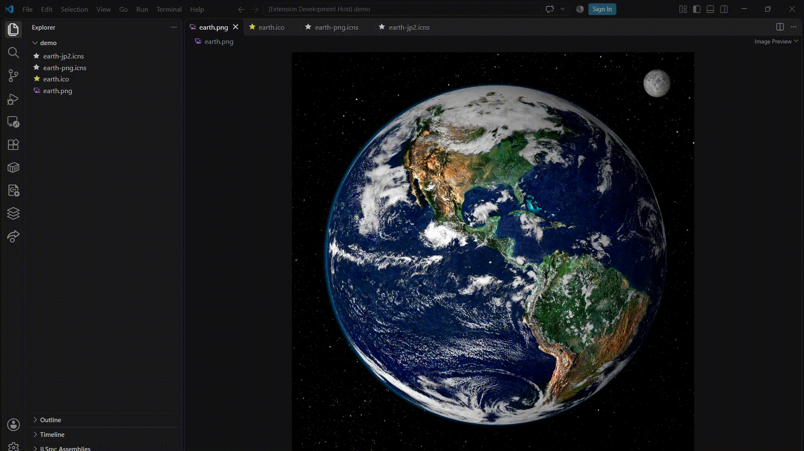

# icns-viewer

  

A VSCode extension that adds a preview for ICNS files.  
Based on the old [`vscode/media-preview`](https://github.com/microsoft/vscode/commit/e7d9908a81db2f0b8f967c28eb2e236d71156aac) extension.  
Supports PNG and JP2 encoding.